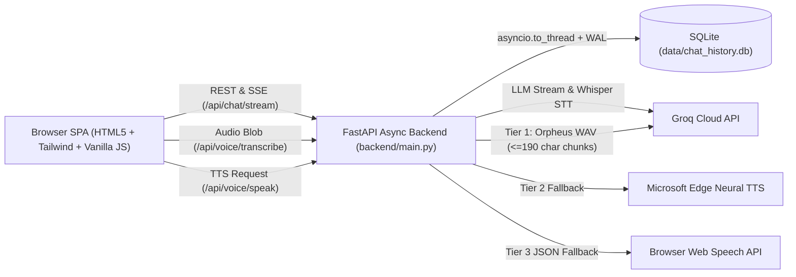

# Enterprise Conversational AI & Voice Assistant

Production-grade, full-stack conversational AI & real-time voice assistant built with **FastAPI**, **SQLite (WAL)**, **Groq Cloud** (`openai/gpt-oss-120b`, `whisper-large-v3-turbo`, `canopylabs/orpheus-v1-english`), **Edge Neural TTS**, and a zero-build dark-mode SPA (`HTML5`, `Tailwind CSS`, `Vanilla JS`, `Web Audio API`).

---

## Architecture Overview



---

## Features

- **Real-Time Token Streaming (SSE):** Sub-second time-to-first-token via Groq (`openai/gpt-oss-120b`) with live `ms` latency and `tokens/sec` throughput badges.
- **Persistent SQLite Multi-Session History:** WAL-enabled SQLite schema (`sessions` + `messages` with cascade delete) supporting instant full-text search across conversation titles, personas, and message bodies.
- **Enterprise Persona Switcher:**
  - `Senior AI Architect`
  - `Executive Assistant`
  - `Technical Interviewer`
- **Full-Duplex Voice Pipeline:**
  - **Speech-to-Text:** Browser `MediaRecorder` (`audio/webm` / `mp4`) transcribed via Groq `whisper-large-v3-turbo`.
  - **3-Tier Speech Synthesis:**
    1. **Tier 1:** Groq `canopylabs/orpheus-v1-english` (`troy`, `diana`, `hannah`, `autumn`, `austin`, `daniel`), automatically chunked (`<=190` chars) and concatenated into valid PCM WAV.
    2. **Tier 2:** `edge-tts` (`en-US-AriaNeural`, etc.) MP3 fallback on rate limits or long text.
    3. **Tier 3:** Structured JSON fallback (`{"fallback": true, "provider": "web_speech"}`) driving the browser's native `window.speechSynthesis`.
- **Live Voice Mode Overlay:** High-DPI HTML5 `<canvas>` audio frequency waveform visualizer powered by Web Audio API `AnalyserNode`, unlocked on user gesture for reliable playback every turn.

---

## Project Structure

```text
AI-Voice-Agent/
├── backend/
│   ├── __init__.py
│   ├── config.py        # Env config, model defaults & voice metadata
│   ├── database.py      # SQLite WAL persistence layer
│   ├── main.py          # FastAPI routes, SSE streaming & static hosting
│   ├── personas.py      # Enterprise system prompts & starter prompts
│   └── services.py      # Groq LLM/Whisper + 3-tier TTS synthesis
├── frontend/
│   ├── index.html       # ChatGPT-style dark-mode SPA & Live Voice modal
│   ├── styles.css       # Custom scrollbars, prose, code blocks & orb CSS
│   └── app.js           # SSE client, MediaRecorder, Web Audio & Canvas UI
├── tests/
│   └── test_api.py      # End-to-end API, SQLite & fallback tests
├── data/                # Runtime SQLite database (gitignored)
├── .env.example
├── .gitignore
├── requirements.txt
└── README.md
```

---

## API Reference

| Method | Endpoint | Description |
| :--- | :--- | :--- |
| `GET` | `/` | Serves the dark-mode SPA |
| `GET` | `/docs` | Interactive Swagger UI |
| `GET` | `/api/health` | Service health & Groq API key configuration state |
| `GET` | `/api/config` | Available personas, models, and TTS voices |
| `GET` | `/api/sessions?q=` | List & search persistent SQLite sessions |
| `POST` | `/api/sessions` | Create a new conversation session |
| `PATCH` | `/api/sessions/{id}` | Update session title or persona |
| `DELETE` | `/api/sessions/{id}` | Delete session and cascaded messages |
| `GET` | `/api/sessions/{id}/messages` | Load full chronological message history |
| `POST` | `/api/chat/stream` | SSE token stream + SQLite persistence + metrics |
| `POST` | `/api/voice/transcribe` | Multipart audio upload -> Groq Whisper STT |
| `POST` | `/api/voice/speak` | Synthesize audio (`audio/wav`, `audio/mpeg`, or JSON fallback) |

---

## Setup & Run (Windows PowerShell)

1. **Allow local virtual environment activation:**
   ```powershell
   Set-ExecutionPolicy -ExecutionPolicy RemoteSigned -Scope CurrentUser -Force
   ```

2. **Create Python 3.12 virtual environment & install dependencies:**
   ```powershell
   py -3.12 -m venv .venv
   .\.venv\Scripts\python.exe -m pip install --prefer-binary -r requirements.txt
   ```

3. **Configure Groq API key in `.env`:**
   Open `.env` and set:
   ```env
   OPENAI_API_KEY="gsk_your_actual_groq_api_key"
   ```

4. **Run automated tests:**
   ```powershell
   .\.venv\Scripts\pytest.exe -v
   ```

5. **Start the FastAPI server:**
   ```powershell
   .\.venv\Scripts\python.exe -m uvicorn backend.main:app --host 127.0.0.1 --port 8000
   ```
   Open **http://127.0.0.1:8000** (or **http://127.0.0.1:8000/docs** for Swagger).
